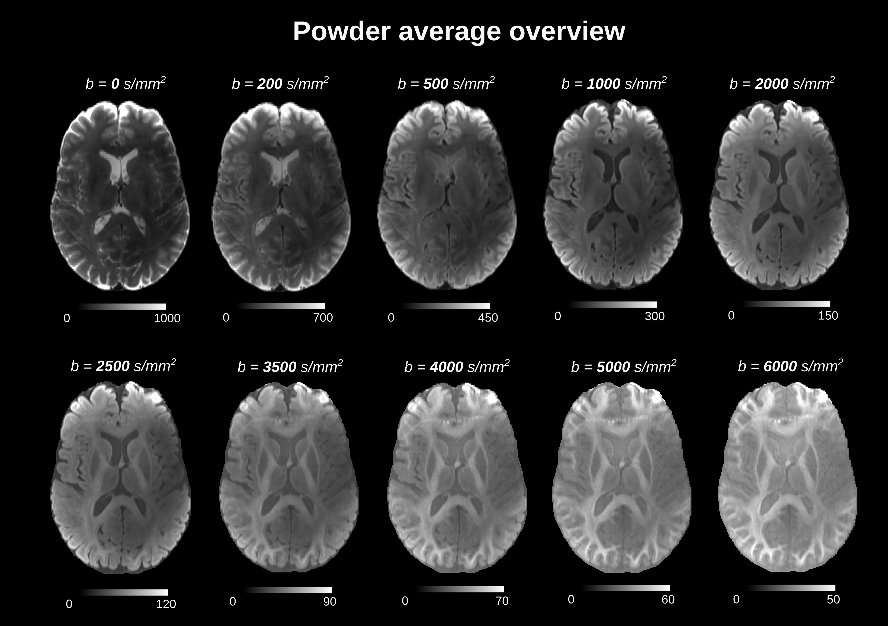

# Human Cortical Microstructure Imaging with Diffusion MRI at 7 Tesla: Methods, Challenges and Future Directions

This repository is dedicated to the openly-accessible 7 Tesla diffusion MRI dataset, accompanying our review manuscript on human cortical microstructure imaging. Full pipelines and dataset files, along with OpenNeuro data upload, will be made available upon manuscript acceptance.

> [!IMPORTANT]  
> The dataset remains accessible only to the reviewers throughout the review process.
> The dataset will be publicly disseminated via OpenNeuro upon publication.
> In case of questions, please contact me via the e-mail below.

**Acquisition and sequence design**: Yi-Hang Tung  
**Contact**: daniel dot uher at ovgu dot de  

## Data overview
**Field strength**: 7T  
**Scanner**: Siemens 7T MAGNETOM Terra.X Impulse Edition (Gmax=200mT/m; Smax=900T/m/s), Siemens Healthineers, Erlangen, Germany  
**Center**: Otto von Guericke University Magdeburg, Department of Biomedical Magnetic Resonance, Magdeburg, Germany  

## Sequence parameters
| **Parameter** | **Value** |
| :--- | :---: |
| Sequence | 2D single-shot EPI |
| Voxel size (mm) | 0.9 isotropic |
| Δ (ms) | 24.14 |
| δ (ms) | 10.42 |
| TE (ms) | 48 |
| TR (ms) | 5500 |
| Multiband factor | 2 |
| Partial Fourier | 0.75 |

*Complete parameter set is, as per usual, within the associated .json file in the acquired data folder*.

### Q-space coverage
| $b$-value ($\text{s/mm}^2$) | Number of Directions |
| :--- | :---: |
| 0 | 20 |
| 200 | 10 |
| 500 | 10 |
| 1000 | 60 |
| 2000 | 60 |
| 2500 | 60 |
| 3500 | 60 |
| 4000 | 60 |
| 5000 | 60 |
| 6000 | 60 |
| :--- | :---: |
| **Total** | **460** |

### Overview of preprocessed data
<picture>
  <source media="(prefers-color-scheme: dark)" srcset="img/powder_average_overview_dpi100.png">
  <source media="(prefers-color-scheme: light)" srcset="img/powder_average_overview_dpi100.png">
  
</picture>

## Preprocessing
Utilized neuroimaging tools: MRtrix31, FSL2, Freesurfer3 (Neurodesk4 Docker container, v8.1.0)  

1. Complex denoising via NORDIC5
2. Degibbs via subvoxel shift1,6
3. Susceptibility distortion correction via TOPUP2,7
4. Eddy and motion correction via eddy2,8
5. Gradient non-linearity correction via gradunwarp9
6. Bias correction via N41,10

Additional steps included brain extraction via *mri_synthstrip*11 and anatomical segmentation plus cortical parcellation via *mri_synthseg*12,13. Signal drift correction has been so far omitted, but will likely be added later on upon additional testing. 

## References
[1] Tournier JD, Smith R, Raffelt D, Tabbara R, Dhollander T, Pietsch M, Christiaens D, Jeurissen B, Yeh CH, Connelly A. MRtrix3: A fast, flexible and open software framework for medical image processing and visualisation. Neuroimage. 2019 Nov 15;202:116137. doi: 10.1016/j.neuroimage.2019.116137. Epub 2019 Aug 29. PMID: 31473352.     
[2] Mark Jenkinson, Christian F. Beckmann, Timothy E.J. Behrens, Mark W. Woolrich, Stephen M. Smith, FSL, NeuroImage, Volume 62, Issue 2, 2012, Pages 782-790, ISSN 1053-8119, https://doi.org/10.1016/j.neuroimage.2011.09.015.     
[3] Fischl B. FreeSurfer. Neuroimage. 2012 Aug 15;62(2):774-81. doi: 10.1016/j.neuroimage.2012.01.021. Epub 2012 Jan 10. PMID: 22248573; PMCID: PMC3685476.     
[4] Renton, A.I., Dao, T.T., Johnstone, T. et al. Neurodesk: an accessible, flexible and portable data analysis environment for reproducible neuroimaging. Nat Methods 21, 804–808 (2024). https://doi.org/10.1038/s41592-023-02145-x.     
[5] Moeller S, Pisharady PK, Ramanna S, Lenglet C, Wu X, Dowdle L, Yacoub E, Uğurbil K, Akçakaya M. NOise reduction with DIstribution Corrected (NORDIC) PCA in dMRI with complex-valued parameter-free locally low-rank processing. Neuroimage. 2021 Feb 1;226:117539. doi: 10.1016/j.neuroimage.2020.117539. Epub 2020 Nov 10. PMID: 33186723; PMCID: PMC7881933.     
[6] Kellner E, Dhital B, Kiselev VG, Reisert M. Gibbs-ringing artifact removal based on local subvoxel-shifts. Magn Reson Med. 2016 Nov;76(5):1574-1581. doi: 10.1002/mrm.26054. Epub 2015 Nov 24. PMID: 26745823.     
[7] Andersson 2003 J.L.R. Andersson, S. Skare, J. Ashburner. How to correct susceptibility distortions in spin-echo echo-planar images: application to diffusion tensor imaging. NeuroImage, 20(2):870-888, 2003.     
[8] Jesper L. R. Andersson and Stamatios N. Sotiropoulos. An integrated approach to correction for off-resonance effects and subject movement in diffusion MR imaging. NeuroImage, 125:1063-1078, 2016.     
[9] *gradunwarp*, Human Connectome Project, https://github.com/Washington-University/gradunwarp     
[10] Tustison NJ, Avants BB, Cook PA, Zheng Y, Egan A, Yushkevich PA, Gee JC. N4ITK: improved N3 bias correction. IEEE Trans Med Imaging. 2010 Jun;29(6):1310-20. doi: 10.1109/TMI.2010.2046908. Epub 2010 Apr 8. PMID: 20378467; PMCID: PMC3071855.  
[11] SynthStrip: Skull-Stripping for Any Brain Image, A Hoopes, JS Mora, AV Dalca, B Fischl, M Hoffmann, NeuroImage 206 (2022), 119474, https://doi.org/10.1016/j.neuroimage.2022.119474.     
[12] SynthSeg: Segmentation of brain MRI scans of any contrast and resolution without retraining
B. Billot, D.N. Greve, O. Puonti, A. Thielscher, K. Van Leemput, B. Fischl, A.V. Dalca, J.E. Iglesias
Medical Image Analysis, 2023.     
[13] Robust machine learning segmentation for large-scale analysis of heterogeneous clinical brain MRI datasets
B. Billot, C. Magdamo, Y. Cheng, S.E. Arnold, S. Das, J.E. Iglesias
PNAS, 2023.     
